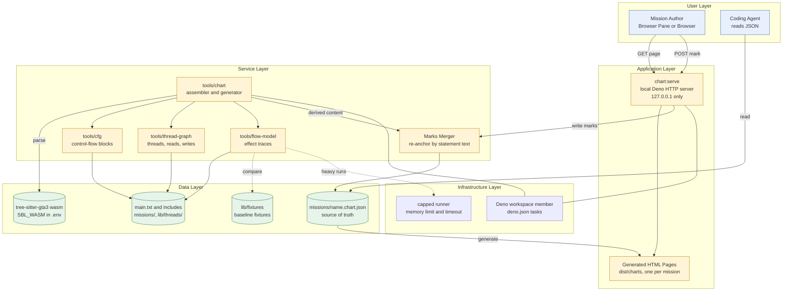

# Mission Baseline Architecture

Architecture for the epic in [mission-baseline.md](mission-baseline.md).

## Epic Architecture Overview

`tools/chart` is a new Deno workspace package. It reads `main.txt` and its
`{$INCLUDE}` files, calls the existing static tools, and writes one
`missions/<name>.chart.json` per in-scope mission (missions 1 to 6). A generator
turns each JSON file into an HTML page in `dist/charts/`. A local Deno server,
started by the `chart:serve` task, serves those pages and writes author marks
back into the mission's JSON.

The JSON has two kinds of content:

| Kind                                                                  | Source                            | Regenerated by `tools/chart`          |
| --------------------------------------------------------------------- | --------------------------------- | ------------------------------------- |
| Derived: shared globals, launch sites, conflicts, behavior traces     | Static tools over the source      | Yes                                   |
| Authored: state marks, each with statement text and an optional label | The author, through the HTML page | No, but re-anchored by statement text |

The mission script is the upstream source. A source change changes the derived
content, and each mark is re-anchored by the text of its statement. A mark whose
statement no longer exists is reported as orphaned and is never dropped without
the author's confirmation.

## System Architecture Diagram

Synchronous path: the browser requests a page and posts a mark, and the server
merges it into the JSON before it replies. Batch path: `tools/chart` regenerates
the derived content and the pages from the source in one run.

## High-Level Features & Technical Enablers

### Features

- Per-mission chart JSON with shared globals, state machine, launch sites,
  conflicts, and behavior traces.
- Conflict report for the three pairs: mission vs thread, thread vs thread, and
  trigger vs running mission, each with both access sites (file, line, access
  kind).
- Launch-site report: file, line, enclosing thread, and guard lines for each
  `Mission.LoadAndLaunchInternal` call.
- Generated HTML page per mission in `dist/charts/`, with a mark control on each
  statement.
- Local server that persists marks into the mission's JSON.
- Effect traces at trace bound 24, with the bound recorded in the JSON.

### Technical Enablers

- The `tools/chart` workspace package and its entry in the root `deno.json`
  workspace list.
- The `chart:serve` task in `deno.json`.
- A JSON schema for `missions/<name>.chart.json`, with a version field.
- A marks merger that re-anchors a mark by statement text and reports orphaned
  marks.
- A measurement of trace bound 24 per mission with the `tools/flow-model`
  library, run through the capped runner, because the bound is unmeasured and
  bound 40 already exhausts a 1500 MB heap for Cop and Intro.
- Library entry points on `tools/cfg`, `tools/thread-graph`, and
  `tools/flow-model`, so `tools/chart` imports them instead of shelling out.
  Each is a Deno workspace member today.
- A test that compares generated JSON for each mission with a stored copy, in
  the style of `lib/thread-graph.test.ts`.
- An `AGENTS.md` run line for the new tool, per the repo rule for kept tools.

## Technology Stack

| Concern           | Choice                                                                                                                                              |
| ----------------- | --------------------------------------------------------------------------------------------------------------------------------------------------- |
| Runtime and tasks | Deno, with `deno.json` workspace                                                                                                                    |
| Parsing           | `tree-sitter-gta3` wasm, located by `SBL_WASM` in `.env`                                                                                            |
| Static analysis   | `tools/cfg`, `tools/thread-graph`, `tools/flow-model`                                                                                               |
| Bounded runs      | Capped runner in `tools/flow-model`                                                                                                                 |
| Server            | `Deno.serve`, bound to `127.0.0.1`                                                                                                                  |
| Pages             | Generated static HTML in `dist/charts/`, with the marking script served beside them; `deno task clean` removes them and the generator rebuilds them |
| Storage           | JSON files in `missions/`, tracked by Git                                                                                                           |
| Tests             | `deno test` with the permissions each file needs                                                                                                    |

New third-party packages are added with `deno add`, JSR first and npm second. No
package is chosen yet.

## Technical Value

High. Mutex and state machine work starts from this map, and refactoring waits
on it. The conflict report names the exact access sites that the mission lock
must cover, and the author-marked states give the state machine its boundaries.

## T-Shirt Size Estimate

L. The assembler over three existing tools is moderate. The marks merger with
re-anchoring, the server with safe writes, the generated pages, and the
trace-bound measurement for six missions each add work, and the Cop and Intro
memory limit adds risk.
