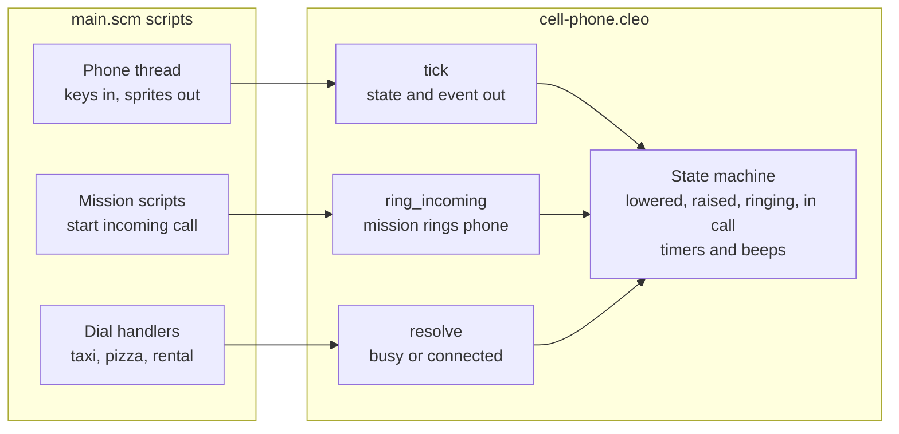

# Cell Phone Implementation Plan

> **For agentic workers:** REQUIRED SUB-SKILL: Use superpowers:subagent-driven-development (recommended) or superpowers:executing-plans to implement this plan task-by-task. Steps use checkbox (`- [ ]`) syntax for tracking.

**Goal:** A CLEO plugin and matching SCM threads let the player raise the cell phone with P, type a number on a seven-digit LCD shown on the HUD, and dial it for a taxi, a pizza, the Oakdale rental, the Zit hotline, or a busy tone.

**Architecture:** The native plugin (`plugins/cell-phone/cell-phone.cpp`, built as `cell-phone.cleo`) owns the phone's state machine, the digit buffer, the timers, and the generated beep. The SCM thread `lib/threads/cellphone.txt` forwards key presses, draws the phone with base-game sprite commands, and runs the dial effects, because mission state and the existing threads live there. The Design section is the spec. This file is both the spec and the plan.

**Tech Stack:** VC CLEO 2.2.0 (`VC.CLEO.asi`), C++17 built with CMake for Win32, Windows `Beep`, Sanny Builder for `main.txt`, Deno tests in `scripts/`.

## Design

### Raising the Phone

- Press P to toggle the phone up and down. The package tracker toggles on O, which frees P.
- While the phone is up, player control is off. Game time keeps running.
- Raising is blocked in a vehicle and during cutscenes.
- Once picked up, the phone is owned for good. It survives death and arrest.
- The character holds the phone in the left hand, arm raised to the face, with the left hand pushing keys.

### Typing and Dialing

- Number keys 0 to 9 type digits. Backspace deletes. Enter dials.
- The display takes seven digits. The Oakdale sign prints `555-76530`, eight digits, while the rental number is `555-7653`. The sign mismatch is logged in [TODO.md](../../docs/TODO.md).
- Escape is not bound. It opens the pause menu as usual. Lowering the phone with Escape is future work in [TODO.md](../../docs/TODO.md).
- Dialing waits about 3 seconds of ring before the result.
- The incoming ringtone is a WAV, the outgoing ring, busy tone, and digit tones are generated by the plugin. See Sound Decisions in [README.md](../../plugins/cell-phone/README.md).

### Incoming Calls

- A mission script sets `$PhoneCaller` to the caller's seven digits, then calls `ring_incoming`. The phone slides up, shows the caller's number, and flashes it (400 ms on, 400 ms off). The ring lasts 20 seconds.
- Player control is not blocked while it rings.
- During a call, the LCD shows the elapsed time as `m:ss` at the right (minutes get a second digit from 10 and stop at 99). The LCD shows the number or the timer, never both: a dialed call keeps its number on screen for the first 500 ms and then the timer replaces it. A dialed call is timed from the moment it is dialed, through the ring, and keeps its clock when it connects. An incoming call is timed from the moment it is answered. The clock runs in game time. The glyphs include a colon texture (61 sprite slots in all).
- A help text (`PHRING`) names the keys: A or Tab answers, and P declines. The help text clears when the ring ends.
- Answering connects the call. Declining or letting it ring out lowers the phone, and a mission script reads the event: `3` hung up, `4` missed, `5` declined.

### Dialed Numbers

- Taxi: a taxi spawns on a nearby road, out of camera view, drives to the player, parks, and stops.
- Pizza: the existing Pizza thread is modified. A pizza moped NPC delivers the pizza to the player.
- Oakdale rental, `555-7653`: a recorded message plays about the apartment. Between 9 am and 5 pm, the player is prompted to buy it if funds allow. Outside those hours, the message plays only. If already owned, the message plays only.
- Zit hotline, `555-0100`: a pager-style text message names the track now playing on the radio. When the player is not driving or the radio is off, the busy tone plays instead. The station-and-time track table is out of scope for this plan.
- Mission numbers: only when unlocked. Which missions can be dialed is **TBD**, expected to be side missions outside the story arc.
- Any other number: busy tone.

### HUD

- The phone face sits in the bottom-right corner, clear of the radar, health, and wanted stars.
- The LCD uses Ember (`#ff7a1a`) on base (`#0d0b1e`), from [palette.csv](../../docs/palette.csv). Shown in the [cellphone mockup](../../docs/specimens/cellphone-mockup.html).

### Look

Sizes are in mockup pixels.

- A candy-bar phone set in 2010, modeled on the [Nokia 1280](https://wikipedia.com/wiki/Nokia_1280). Top to bottom: a speaker slot, the LCD, a navigation cluster, and a 12-key keypad.
- No antenna. The body is the surface color (`#17142e`), 200 px wide, with 22 px rounded top corners and square bottom corners.
- Cold Twilight blue trim (`#4d94ff`), 2 px, only around the speaker slot (52 by 6 px) and the LCD (60 px tall). Nothing else on the phone has blue trim.
- The LCD shows the typed digits left-aligned in Ember, with a dash after the third digit and no cursor.
- The LCD digits are sprites, not game text. The game has no monospaced font, its text wrapped the digits, and EasyFont (a TTF font ASI for Vice City 1.0) crashed the game at launch. Each glyph (`0` to `9` and the dash) is a white texture rendered from the mockup's Courier New, drawn on a grid of equal cells and tinted by the sprite color: Ember when lit, the muted color at 18% alpha when not. That makes 60 sprite slots in all.
- The navigation cluster has two soft keys (24 px tall, each with a 12 by 2 px dash), a 76 px round D-pad with four triangle arrows and a base-colored center, an answer key (handset icon in the pass color `#00d9a3`), and a hang-up key (handset icon in the fail color `#ff4a2b`).
- The keypad is 3 by 4 pill keys, 34 px tall with 8 px gaps. Keys 2 to 9 carry letters (ITU E.161), key 1 carries the voicemail symbol, and the bottom row is `*`, `0`, and `#`.
- Keys are raised rubber: a top highlight, a 4 px lip in the base color under each key, and a faint Ember glow (`0 0 4px` at 0.2 opacity) while lit.
- Pressed, a key (and the D-pad) sinks 4 px into its lip, the top highlight turns to shade, and the lip shadow goes. A lit pressed key's glyph glows brighter. It holds while the key is down.
- Lit, keys and digits are Ember, and the call keys keep their pass and fail colors. Unlit, keys dim to 30% and the LCD digits to 18% of the muted color.
- The backlight is on when the phone is raised. It goes dark 5 seconds after the last key press, or 5 seconds after raising if no key is pressed.
- The phone sits at the bottom of the HUD, with its last key row 13 px above the screen edge and its bottom edge cut off by the screen. Raising slides it up from below the screen edge over 0.55 s, and lowering slides it back down.
- The body, keys, D-pad, call keys, and speaker slot are rendered from the mockup to textures.
- The in-hand brick model is out of scope. [TODO.md](../../docs/TODO.md) tracks its remodel.

### Plugin Interface

The plugin owns the state machine and adds three opcodes. Every script that touches the phone lives in `main.scm`, so scripts read the phone's state through globals that the phone thread mirrors from `tick`. The HUD is drawn by the base-game script commands `038D` DRAW_SPRITE, `038E` DRAW_RECT, `0390` LOAD_TEXTURE_DICTIONARY, and `038F` LOAD_SPRITE (confirmed in the [Sanny Builder library data for Vice City](https://raw.githubusercontent.com/sannybuilder/library/master/vc/vc.json)). The plugin has no D3D hook and no ImGui.



| Opcode | Inputs | Outputs |
|---|---|---|
| `0B40 tick` | key code, blocked flag | state, lit, animating (0 or 1), digit count, number, event |
| `0B41 ring_incoming` | none | none |
| `0B42 resolve` | result: 1 connected, 2 busy, 3 call over | none |

- Key codes: `-1` none, `0` to `9` digits, `10` Backspace, `11` dial (Enter), `12` Escape, `13` toggle (P), `14` answer (Tab).
- States: `0` lowered, `1` raised, `2` ringing out, `3` dialed (waiting for `resolve`), `4` ringing in, `5` connected.
- Events, one per frame: `0` none, `1` dial done, `2` answered, `3` hung up, `4` missed, `5` declined (P while ringing in).
- `tick` runs once per frame. The script passes `blocked` as 1 in a vehicle or a cutscene, and the plugin lowers the phone while it is 1.
- The plugin runs the 3-second ring after Enter, the 5-second backlight, the slide animation, and every beep.
- `number` holds the dialed digits as an integer, and the digit count restores leading zeros.
- Incoming calls: a mission script sets `$PhoneCaller`, then calls `ring_incoming`, and the player answers with A or Tab. The `Cell` thread moves onto this opcode. While ringing in, the plugin shows the phone (`animating` covers the slide), keeps it backlit, and answers P with a decline.

## Global Constraints

- The game is `gta-vc.exe` v1.0, 32-bit. The plugin builds as Win32 only (`cmake -A Win32`).
- The plugin checks `CLEO_GetVersion` on load and refuses to load on an older CLEO. The installed CLEO is v2.0.0.6 (`cleo.log`), and `CLEO_GetVersion()` returns it packed as `0x00020006`, so the plugin requires `0x00020000` or newer. An earlier check packed the version as `2 << 24` and always failed with "An incorrect version of CLEO was loaded", and every `0B40` call then logged an incorrect opcode.
- Plugin opcodes are `0B40` to `0B42` only. Upstream `scm.txt` lists `0B00` to `0B21` and `0BA2` to `0BA4` as taken, and `0B40` to `0B4F` as free.
- Keys: `P` raises and lowers the phone. `Escape` is not bound. `Tab` already answers calls in the `Cell` thread, so the phone must not use it. `O` toggles the package tracker, and `Q` stays with the game's weapon switch. Digits `0` to `9` type, `Backspace` deletes, and `Enter` dials.
- The display holds seven digits.
- Ring lasts 3 seconds, then the result follows.
- `main.txt` is Windows-1252, and Edit refuses it. Change it with the encoding-safe `replace-once.ts` script in `.agents/skills/debug-missions/scripts/`, after reading that script's header for its arguments.
- Deno tests that read `main.txt` decode it as `windows-1252`, as `scripts/intro-pickup.test.ts` does.
- The working tree already has an uncommitted one-line deletion in `lib/threads/pizza.txt`. Keep it, and build on top of it.
- Never run `git commit`. The user alone commits.

## File Structure

- Create: `plugins/cell-phone/CMakeLists.txt` (CMake, Win32, a test target, and the plugin target)
- Create: `plugins/cell-phone/phone_machine.h` (the `PhoneMachine` state machine, header only)
- Create: `plugins/cell-phone/tests/phone_machine_test.cpp` (native test for `PhoneMachine`)
- Create: `plugins/cell-phone/cell-phone.cpp` (opcodes `0B40` to `0B42`, beep)
- Create: `scripts/render-phone-textures.ts` (renders the mockup parts to PNG for the TXD)
- Create: `plugins/cell-phone/sdk/VC.CLEO.h` and `plugins/cell-phone/sdk/VC.CLEO.lib` (fetched from upstream)
- Create: `plugins/cell-phone/.gitignore` (`build/`)
- Create: `lib/threads/cellphone.txt` (raise state, keys, digits, dialing, effects)
- Create: `scripts/cell-phone-keys.test.ts` and `scripts/cell-phone.test.ts` (Deno tests)
- Modify: `main.txt` (tracker keys at lines 669, 670, and 683; one `{$INCLUDE lib/threads/cellphone.txt}` after line 370)
- Modify: `lib/init.txt` (start `@CellPhone` beside the other free-roam starts)
- Modify: `lib/threads/pizza.txt` (a dialed-pizza path, added beside the existing `Pizza` thread)
- Modify: `scripts/install.ts` (copy `cell-phone.cleo` into the game's `CLEO` folder)

## Task 1: Make O Toggle the Package Tracker

**Files:**
- Test: `scripts/cell-phone-keys.test.ts`
- Modify: `main.txt:655` to `main.txt:687` (the tracker toggle block)

**Interfaces:**
- Consumes: nothing.
- Produces: `O` toggles the tracker on and off, and `P` is free for the phone.

- [x] **Step 1: Write the failing test**

```ts
const mainPath = new URL("../main.txt", import.meta.url);

Deno.test("Package tracker toggles with O, leaving P and Q free", async () => {
  const source = new TextDecoder("windows-1252").decode(
    await Deno.readFile(mainPath),
  );
  const start = source.indexOf("// --- TRACKER TOGGLE CONTROLS ---");
  const end = source.indexOf("\nwait 250", start);

  if (start < 0 || end < 0) {
    throw new Error("Tracker toggle block boundaries were not found");
  }

  const block = source.slice(start, end);
  if (block.includes("KeyCode.P") || block.includes("KeyCode.Q")) {
    throw new Error("The tracker block must not read P or Q");
  }
  if (!block.includes("Pad.IsKeyPressed(KeyCode.O)")) {
    throw new Error("The tracker must toggle with O");
  }
});
```

- [x] **Step 2: Run the test to verify it fails**

Run: `deno test scripts/cell-phone-keys.test.ts`
Expected: FAIL with "The tracker block must not read P or Q"

- [x] **Step 3: Replace the toggle block**

Read the header of `.agents/skills/debug-missions/scripts/replace-once.ts`, read `main.txt` lines 655 to 687, then use the script to replace that block with this one (the original O and P branches become one O toggle on `$PackHunt`):

```
    // --- TRACKER TOGGLE CONTROLS ---
    if
        Pad.IsKeyPressed(KeyCode.O)
    then
        if
            not $Packages >= 88
        then
            if
                $PackHunt == 1
            then
                // Press 'O' to turn OFF radar tracker
                Text.PrintHelp('PACKOFF')
                $PackHunt = 0
                Blip.Remove($CurrentPackBlip)
                terminate_all_scripts_with_this_name 'PACKAGE'
            else
                // Press 'O' to turn ON radar tracker
                $PackHunt = 1
                Text.PrintHelp('PACKON')
                wait 0
                start_new_script @PACKAGE
            end
        else
            // Player pressed toggle after collecting everything
            Text.PrintHelp('PACKDON')
        end
        wait 500
    end
```

Then search the repo for the help keys `PACKON`, `PACKOFF`, `PACKDON`, `PACKHL1`, `PACKHL2`, and `PACKHLP`, and change any text that names the P key to name O.

- [x] **Step 4: Run the test to verify it passes**

Run: `deno test scripts/cell-phone-keys.test.ts`
Expected: PASS

- [x] **Step 5: Read back and stop**

Read the changed block in `main.txt` and confirm it matches the block above and nothing else changed. Do not run `git add` or `git commit`.

## Task 2: Confirm Sanny Builder Names

**Files:**
- Read only: the Sanny Builder Library, through the `sanny-guidance` skill.

**Interfaces:**
- Consumes: nothing.
- Produces: a confirmed name for each opcode in the list below. Tasks 7 to 11 use these names.

- [x] **Step 1: Look up each name**

Use the `sanny-guidance` skill, and look up each command in the Sanny Builder Library before writing it:
- Key codes for `0` to `9`, `Enter`, `Backspace`, and `Escape`. The repo already uses `KeyCode.Tab`, `KeyCode.O`, `KeyCode.P`, and `KeyCode.Q`, so letters are confirmed.
- Player checks: in a vehicle, and control state. The `Cell` thread uses `Player.SetControl` and `Char.SetAnsweringMobile`.
- Clock: a time-of-day getter. The repo has `Clock.SetTimeOfDay` only.
- Money: a getter for the player's cash. The `Pickup.CreateForSaleProperty` calls in `init.txt` show the price arguments.
- Road: the nearest road node to a coordinate, car creation at that node, a drive-to and park command, and a point-in-camera check. The repo has `Car.Create` only.
- Radio: whether the radio is on, and the current station. Task 11 needs this.

- [x] **Step 2: Record the results** (recorded in [README.md](../../plugins/cell-phone/README.md))

Add a line under this task for each name that resolves, with the opcode name exactly as the library writes it. If a name does not exist, stop and report it, because Tasks 8 and 11 depend on it.

## Task 3: Scaffold the Plugin and Build the State Machine

**Files:**
- Create: `plugins/cell-phone/sdk/VC.CLEO.h`, `plugins/cell-phone/sdk/VC.CLEO.lib`
- Create: `plugins/cell-phone/.gitignore`
- Create: `plugins/cell-phone/phone_machine.h`
- Create: `plugins/cell-phone/tests/phone_machine_test.cpp`
- Create: `plugins/cell-phone/CMakeLists.txt`

**Interfaces:**
- Consumes: nothing.
- Produces: `PhoneMachine` with `PhoneView Tick(uint32_t now, int key, bool blocked)`, `void RingIncoming(uint32_t now)`, `void Resolve(uint32_t now, int result)`, and `PhoneBeep TakeBeep()`. `PhoneView` holds `state`, `lit`, `animating`, `digitCount`, `number`, and `event`. Task 4 wraps these in opcodes.

- [x] **Step 1: Fetch the SDK from upstream**

Run in PowerShell from the repo root:

```powershell
New-Item -ItemType Directory -Force plugins/cell-phone/sdk | Out-Null
Invoke-WebRequest -Uri https://raw.githubusercontent.com/cleolibrary/III.VC.CLEO/master/source/CLEO_SDK/VC.CLEO.h -OutFile plugins/cell-phone/sdk/VC.CLEO.h
Invoke-WebRequest -Uri https://raw.githubusercontent.com/cleolibrary/III.VC.CLEO/master/source/CLEO_SDK/VC.CLEO.lib -OutFile plugins/cell-phone/sdk/VC.CLEO.lib
```

- [x] **Step 2: Write the `.gitignore`**

Create `plugins/cell-phone/.gitignore` with one line: `build/`

- [x] **Step 3: Write the failing test**

Create `plugins/cell-phone/tests/phone_machine_test.cpp`. Time is a parameter, so the tests run without waiting.

```cpp
#include "phone_machine.h"

#include <cstdio>

#define CHECK(condition)                                                              \
    do                                                                                \
    {                                                                                 \
        if (!(condition))                                                             \
        {                                                                             \
            std::fprintf(stderr, "FAILED %s:%d: %s\n", __FILE__, __LINE__, #condition); \
            return 1;                                                                 \
        }                                                                             \
    } while (0)

static PhoneView Tick(PhoneMachine &m, uint32_t now, int key = KeyNone, bool blocked = false)
{
    return m.Tick(now, key, blocked);
}

static void TypeNumber(PhoneMachine &m, uint32_t now, const char *digits)
{
    for (const char *d = digits; *d; ++d)
    {
        Tick(m, now, *d - '0');
    }
}

int main()
{
    {
        PhoneMachine m;
        CHECK(Tick(m, 0).state == StateLowered);
        PhoneView v = Tick(m, 0, KeyToggle);
        CHECK(v.state == StateRaised && v.animating == 1 && v.lit == 1);
        CHECK(Tick(m, 549).animating == 1);
        CHECK(Tick(m, 550).animating == 0);
        CHECK(Tick(m, 600, KeyToggle).state == StateLowered);
    }
    {
        PhoneMachine m;
        Tick(m, 0, KeyToggle);
        TypeNumber(m, 100, "55576539");
        PhoneView v = Tick(m, 100);
        CHECK(v.digitCount == 7 && v.number == 5557653);
        CHECK(Tick(m, 100, KeyBackspace).digitCount == 6);
    }
    {
        PhoneMachine m;
        Tick(m, 0, KeyToggle);
        TypeNumber(m, 100, "5557653");
        CHECK(Tick(m, 1000, KeyDial).state == StateRingingOut);
        CHECK(m.TakeBeep() == BeepRing);
        CHECK(Tick(m, 3999).event == EventNone);
        PhoneView v = Tick(m, 4000);
        CHECK(v.state == StateDialed && v.event == EventDialDone && v.number == 5557653);
        m.Resolve(4100, ResultBusy);
        CHECK(m.TakeBeep() == BeepBusy);
        v = Tick(m, 4200);
        CHECK(v.state == StateRaised && v.digitCount == 7);
    }
    {
        PhoneMachine m;
        Tick(m, 0, KeyToggle);
        TypeNumber(m, 100, "5550100");
        Tick(m, 200, KeyDial);
        Tick(m, 3200);
        m.Resolve(3300, ResultConnected);
        CHECK(Tick(m, 3400).state == StateConnected);
        m.Resolve(3500, ResultOver);
        CHECK(Tick(m, 3600).state == StateLowered);
    }
    {
        PhoneMachine m;
        Tick(m, 0, KeyToggle);
        Tick(m, 3000, 5);
        CHECK(Tick(m, 7999).lit == 1);
        CHECK(Tick(m, 8000).lit == 0);
    }
    {
        PhoneMachine m;
        Tick(m, 0, KeyToggle);
        CHECK(Tick(m, 100, KeyNone, true).state == StateLowered);
        CHECK(Tick(m, 200, KeyToggle, true).state == StateLowered);
    }
    {
        PhoneMachine m;
        m.RingIncoming(100);
        CHECK(Tick(m, 200).state == StateRingingIn);
        CHECK(m.TakeBeep() == BeepRing);
        PhoneView v = Tick(m, 300, KeyAnswer);
        CHECK(v.state == StateConnected && v.event == EventAnswered);
        CHECK(Tick(m, 400, KeyEscape).event == EventHungUp);
    }
    {
        PhoneMachine m;
        m.RingIncoming(0);
        CHECK(Tick(m, 19999).state == StateRingingIn);
        PhoneView v = Tick(m, 20000);
        CHECK(v.state == StateLowered && v.event == EventMissed);
    }
    return 0;
}
```

- [x] **Step 4: Write the CMake file with only the test target**

Create `plugins/cell-phone/CMakeLists.txt`:

```cmake
cmake_minimum_required(VERSION 3.20)
project(cell_phone LANGUAGES CXX)

set(CMAKE_CXX_STANDARD 17)
set(CMAKE_CXX_STANDARD_REQUIRED ON)

enable_testing()

add_executable(phone_machine_test tests/phone_machine_test.cpp)
target_include_directories(phone_machine_test PRIVATE ${CMAKE_CURRENT_SOURCE_DIR})
add_test(NAME phone_machine COMMAND phone_machine_test)
```

- [x] **Step 5: Run the test to verify it fails**

Run: `cmake -S plugins/cell-phone -B plugins/cell-phone/build -A Win32`, then `cmake --build plugins/cell-phone/build --config Release`
Expected: FAIL, because `phone_machine.h` does not exist yet.

- [x] **Step 6: Write `phone_machine.h`**

Create `plugins/cell-phone/phone_machine.h`:

```cpp
#pragma once

#include <cstdint>
#include <string>

enum PhoneKey { KeyNone = -1, KeyBackspace = 10, KeyDial = 11, KeyEscape = 12, KeyToggle = 13, KeyAnswer = 14 };
enum PhoneState { StateLowered, StateRaised, StateRingingOut, StateDialed, StateRingingIn, StateConnected };
enum PhoneEvent { EventNone, EventDialDone, EventAnswered, EventHungUp, EventMissed };
enum PhoneBeep { BeepNone, BeepRing, BeepBusy };
enum PhoneResult { ResultConnected = 1, ResultBusy = 2, ResultOver = 3 };

/** @brief What the script reads each frame. `animating` is 1 while the phone slides up or down. */
struct PhoneView
{
    int state;
    int lit;
    int animating;
    int digitCount;
    int number;
    int event;
};

/** @brief The phone's state, digits, and timers. Time is passed in, so tests need no clock. */
class PhoneMachine
{
public:
    static constexpr int kMaxDigits = 7;
    static constexpr uint32_t kBacklightMs = 5000;
    static constexpr uint32_t kSlideMs = 550;
    static constexpr uint32_t kRingOutMs = 3000;
    static constexpr uint32_t kRingOutBeatMs = 1000;
    static constexpr uint32_t kRingInMs = 20000;
    static constexpr uint32_t kRingInBeatMs = 2000;

    /** @brief Handles one key (or KeyNone), then runs the timers. A blocked phone lowers and ignores keys. */
    PhoneView Tick(uint32_t now, int key, bool blocked)
    {
        int event = EventNone;
        const bool up = m_state != StateLowered && m_state != StateRingingIn;
        if (blocked)
        {
            if (up)
            {
                Lower(now);
            }
        }
        else
        {
            event = HandleKey(now, key);
        }
        if (m_state == StateRingingOut)
        {
            if (now >= m_nextBeat && now < m_phaseStart + kRingOutMs)
            {
                m_beep = BeepRing;
                m_nextBeat += kRingOutBeatMs;
            }
            if (now >= m_phaseStart + kRingOutMs)
            {
                m_state = StateDialed;
                event = EventDialDone;
            }
        }
        else if (m_state == StateRingingIn)
        {
            if (now >= m_nextBeat)
            {
                m_beep = BeepRing;
                m_nextBeat += kRingInBeatMs;
            }
            if (now >= m_phaseStart + kRingInMs)
            {
                m_state = StateLowered;
                event = EventMissed;
            }
        }
        int number = 0;
        for (char c : m_digits)
        {
            number = number * 10 + (c - '0');
        }
        return PhoneView{m_state, now < m_litUntil ? 1 : 0, m_slid && now - m_slideStart < kSlideMs ? 1 : 0,
                         static_cast<int>(m_digits.size()), number, event};
    }

    /** @brief Starts an incoming ring. Ignored unless the phone is lowered. */
    void RingIncoming(uint32_t now)
    {
        if (m_state != StateLowered)
        {
            return;
        }
        m_state = StateRingingIn;
        m_phaseStart = now;
        m_nextBeat = now + kRingInBeatMs;
        m_beep = BeepRing;
    }

    /** @brief The script's answer to a dialed number (state Dialed), or the end of a connected call. */
    void Resolve(uint32_t now, int result)
    {
        if (result == ResultConnected && m_state == StateDialed)
        {
            m_state = StateConnected;
            Light(now);
        }
        else if (result == ResultBusy && m_state == StateDialed)
        {
            m_state = StateRaised;
            m_beep = BeepBusy;
            Light(now);
        }
        else if (result == ResultOver && (m_state == StateDialed || m_state == StateConnected))
        {
            Lower(now);
        }
    }

    /** @brief Returns the beep to play now and clears it. */
    PhoneBeep TakeBeep()
    {
        const PhoneBeep beep = m_beep;
        m_beep = BeepNone;
        return beep;
    }

private:
    int HandleKey(uint32_t now, int key)
    {
        switch (m_state)
        {
        case StateLowered:
            if (key == KeyToggle)
            {
                Raise(now);
            }
            break;
        case StateRaised:
            if (key >= 0 && key <= 9)
            {
                if (static_cast<int>(m_digits.size()) < kMaxDigits)
                {
                    m_digits.push_back(static_cast<char>('0' + key));
                }
                Light(now);
            }
            else if (key == KeyBackspace)
            {
                if (!m_digits.empty())
                {
                    m_digits.pop_back();
                }
                Light(now);
            }
            else if (key == KeyDial && !m_digits.empty())
            {
                m_state = StateRingingOut;
                m_phaseStart = now;
                m_nextBeat = now + kRingOutBeatMs;
                m_beep = BeepRing;
                Light(now);
            }
            else if (key == KeyToggle || key == KeyEscape)
            {
                Lower(now);
            }
            break;
        case StateRingingOut:
        case StateDialed:
            if (key == KeyToggle || key == KeyEscape)
            {
                Lower(now);
            }
            break;
        case StateRingingIn:
            if (key == KeyAnswer)
            {
                m_state = StateConnected;
                StartSlide(now);
                Light(now);
                return EventAnswered;
            }
            break;
        case StateConnected:
            if (key == KeyToggle || key == KeyEscape)
            {
                Lower(now);
                return EventHungUp;
            }
            break;
        }
        return EventNone;
    }

    void StartSlide(uint32_t now)
    {
        m_slid = true;
        m_slideStart = now;
    }

    void Light(uint32_t now) { m_litUntil = now + kBacklightMs; }

    void Raise(uint32_t now)
    {
        m_state = StateRaised;
        m_digits.clear();
        StartSlide(now);
        Light(now);
    }

    void Lower(uint32_t now)
    {
        m_state = StateLowered;
        m_digits.clear();
        m_litUntil = 0;
        StartSlide(now);
    }

    PhoneState m_state = StateLowered;
    PhoneBeep m_beep = BeepNone;
    std::string m_digits;
    uint32_t m_litUntil = 0;
    uint32_t m_phaseStart = 0;
    uint32_t m_nextBeat = 0;
    uint32_t m_slideStart = 0;
    bool m_slid = false;
};
```

- [x] **Step 7: Run the test to verify it passes**

Run: `cmake -S plugins/cell-phone -B plugins/cell-phone/build -A Win32`, then `cmake --build plugins/cell-phone/build --config Release`, then `ctest --test-dir plugins/cell-phone/build -C Release --output-on-failure`
Expected: PASS, `phone_machine` passes.

- [x] **Step 8: Stop**

Do not run `git add` or `git commit`. The user alone commits.

## Task 4: Plugin Opcodes and Beep

**Files:**
- Create: `plugins/cell-phone/cell-phone.cpp`
- Modify: `plugins/cell-phone/CMakeLists.txt` (add the plugin target)

**Interfaces:**
- Consumes: `PhoneMachine` from Task 3.
- Produces:
  - `0B40: cell_phone_tick key blocked -> state lit animating digit_count number event`
  - `0B41: cell_phone_ring_incoming`
  - `0B42: cell_phone_resolve result` with 1 connected, 2 busy, 3 call over.

- [x] **Step 1: Check the upstream demo plugins for the version constant and the output write-back pattern**

Open the `demo_plugins` directory of `cleolibrary/III.VC.CLEO` through the GitHub API, and read one plugin that writes output variables. Copy its `CLEO_VERSION` macro and its `Store` call, and use the same pattern for the six outputs of `0B40`.

- [x] **Step 2: Write `cell-phone.cpp`** (beep playback deferred until the ringtone design is settled, so the opcodes drain and drop `TakeBeep()`)

Create `plugins/cell-phone/cell-phone.cpp`:

```cpp
/**
 * @file cell-phone.cpp
 * @brief CLEO plugin for the Eventide Chronicles cell phone, Vice City.
 *
 * Wraps the PhoneMachine state machine in three opcodes and plays its ring and busy tones.
 */

#define WIN32_LEAN_AND_MEAN
#include <windows.h>
#include <thread>

#include "VC.CLEO.h"
#include "phone_machine.h"

/** @brief Pointer to the CLEO parameter buffer shared with the calling script. */
static tScriptVar *Params;

static PhoneMachine g_phone;

/** @brief Plays a beep on a worker thread, so the game loop never waits. */
static void PlayBeep(PhoneBeep beep)
{
    if (beep == BeepNone)
    {
        return;
    }
    std::thread([beep]() {
        if (beep == BeepBusy)
        {
            for (int i = 0; i < 3; ++i)
            {
                Beep(480, 200);
                Sleep(200);
            }
        }
        else
        {
            Beep(440, 400);
        }
    }).detach();
}

/**
 * @brief Opcode 0B40: run one frame of the phone.
 *
 * Inputs: key code, blocked flag. Outputs: state, lit, animating, digit count, number, event.
 */
eOpcodeResult WINAPI OPCODE_0B40(CScript *script)
{
    script->Collect(2);
    const int key = Params[0].nVar;
    const bool blocked = Params[1].nVar != 0;
    const PhoneView view = g_phone.Tick(GetTickCount(), key, blocked);
    PlayBeep(g_phone.TakeBeep());
    Params[0].nVar = view.state;
    Params[1].nVar = view.lit;
    Params[2].nVar = view.animating;
    Params[3].nVar = view.digitCount;
    Params[4].nVar = view.number;
    Params[5].nVar = view.event;
    script->Store(6);
    return OR_CONTINUE;
}

/** @brief Opcode 0B41: start an incoming call. */
eOpcodeResult WINAPI OPCODE_0B41(CScript *script)
{
    g_phone.RingIncoming(GetTickCount());
    PlayBeep(g_phone.TakeBeep());
    return OR_CONTINUE;
}

/** @brief Opcode 0B42: report the outcome of a dialed number, or end a call. Input: result. */
eOpcodeResult WINAPI OPCODE_0B42(CScript *script)
{
    script->Collect(1);
    g_phone.Resolve(GetTickCount(), Params[0].nVar);
    PlayBeep(g_phone.TakeBeep());
    return OR_CONTINUE;
}

/** @brief DLL_PROCESS_ATTACH checks the CLEO version, caches the parameter buffer, and registers opcodes 0B40 to 0B42. */
BOOL APIENTRY DllMain(HMODULE hModule, DWORD reason, LPVOID lpReserved)
{
    if (reason == DLL_PROCESS_ATTACH)
    {
        if (CLEO_GetVersion() < CLEO_VERSION)
        {
            return FALSE;
        }
        Params = CLEO_GetParamsAddress();
        Opcodes::RegisterOpcode(0x0B40, OPCODE_0B40);
        Opcodes::RegisterOpcode(0x0B41, OPCODE_0B41);
        Opcodes::RegisterOpcode(0x0B42, OPCODE_0B42);
    }
    return TRUE;
}
```

Replace `CLEO_VERSION` with the macro value copied in Step 1.

- [x] **Step 3: Add the plugin target to `CMakeLists.txt`**

Append:

```cmake
add_library(cell-phone SHARED cell-phone.cpp)
set_target_properties(cell-phone PROPERTIES SUFFIX ".cleo" PREFIX "")
target_include_directories(cell-phone PRIVATE ${CMAKE_CURRENT_SOURCE_DIR}/sdk ${CMAKE_CURRENT_SOURCE_DIR})
target_link_libraries(cell-phone PRIVATE "${CMAKE_CURRENT_SOURCE_DIR}/sdk/VC.CLEO.lib")
```

- [x] **Step 4: Build and run the tests**

Run: `cmake -S plugins/cell-phone -B plugins/cell-phone/build -A Win32`, then `cmake --build plugins/cell-phone/build --config Release`, then `ctest --test-dir plugins/cell-phone/build -C Release --output-on-failure`
Expected: the build produces `plugins/cell-phone/build/Release/cell-phone.cleo`, and `phone_machine` passes.

- [x] **Step 5: Stop**

Do not run `git add` or `git commit`. The user alone commits.

## Task 5: Sprite Spike (Gate)

**Files:**
- Modify: this file, the "Spike Findings" list below.

**Interfaces:**
- Consumes: nothing from earlier tasks.
- Produces: where `0390` finds a TXD, the sprite coordinate space, and whether the GXT digit text works. Tasks 6 and 7 depend on these.

- [x] **Step 1: Pack one test texture**

Read the usage header of `scripts/import-skin.ts`, then pack one PNG into `phtest.txd` with `deno task import-skin`. Packed into `dist/phtest/phtest.txd` (64 by 64). Test it in isolation with `deno task probe sprites`, which runs `tests/sprites-probe.txt` as the only main script and restores the game's `main.scm` afterward.

- [x] **Step 2: Find where `0390` loads a TXD from**

In a throwaway thread, call `0390: load_texture_dictionary 'phtest'`, `038F: load_sprite 1 'phtest'`, and `038D: draw_sprite 1 at 320.0 240.0 size 64.0 64.0 RGBA 255 255 255 255` every frame. Try the TXD in the locations the game reads (start with `models\txd\`, then inside `gta3.img` through `deno task install:skins`). Read `scrlog.log` and ask the user what the screen shows. Record the working location.

- [x] **Step 3: Record the coordinate space and text**

Record whether the sprite position uses a 640 by 448 space, how it behaves in widescreen, and the longest texture name that loads. Also draw one digit with a GXT key (`PHDIG` holding `~1~`) through `DISPLAY_TEXT_WITH_NUMBER`. The `strings.fxt` loader in VC is unverified, so record whether the key resolves.

- [x] **Step 4: Gate**

If `0390` cannot load a TXD, Task 6 is replaced by a face built from `038E DRAW_RECT` boxes in palette colors, with no textures.

**Spike Findings:**
- TXD location: `models\phtest.txd` in the game folder loads and draws (reported). `models\txd\` does not exist in this install.
- Texture names: `0390` and `038F` take 8-byte labels (single quotes). A double-quoted name froze the game inside `0390`. A name over 7 characters was not tested, so keep texture names within 7.
- Coordinate space and widescreen: a 640 by 448 space, as the [033E page](https://gtamods.com/wiki/033E) says (the first reading, 480 high, was wrong: the bottom corner marks at y 476 were off screen, and the phone placed for 480 sat about one key row too low). In the 1194 by 586 window the green corner marks sit at the screen edges, so x spans the full width. The magenta marks sit on the sprite's corners, so x and y are the sprite's center. A 64 by 64 sprite draws wider than tall, so widescreen stretches x and the HUD art must be authored with that in mind.
- GXT digit text: with `PHDIG ~1~` in `strings.fxt`, `DisplayWithNumber` with a single-quoted key draws the digit (a 7 appears near the top center in the screenshot).
- Gate: `0390` loads a TXD, so Task 6 keeps textures.

## Task 6: Render the Phone Textures

**Files:**
- Create: `scripts/render-phone-textures.ts`
- Modify: `deno.json` (add `npm:puppeteer-core`)
- Output: `dist/phone/*.png`, packed into `phone.txd`

**Interfaces:**
- Consumes: [cellphone-mockup.html](../../docs/specimens/cellphone-mockup.html) and the install location from Task 5.
- Produces: one PNG per part, in unlit, lit, and pressed states where the part has them: `body`, `soft`, `dpad`, `ans`, `hang`, `key0` to `key9`, `keyst`, and `keyhs`, each with a `_u`, `_l`, or `_p` suffix except `body`. The `body` texture is composited with the speaker slot and the LCD frame, so those cost no sprite slots (49 slots in all). Every name with its suffix stays within 7 characters (the longest are `keyst_u` and `keyhs_u`), because the Task 5 spike did not test an 8-character name.

- [x] **Step 1: Add the dependency**

Run `deno add npm:puppeteer-core`. Set `CHROME` in `.env` to the path of an installed Chrome. `puppeteer-core` downloads no browser, and the script drives the installed Chrome only.

- [x] **Step 2: Write the render script** (`deno task render-phone`, 51 textures in `dist/phone/`, sizes in `dist/phone/sizes.csv`)

The script opens the mockup, waits for the raise slide, then for each part selector sets the `lit` class on `.phone` (lit) or removes it (unlit), waits 500 ms for the color transition, and screenshots the element with a transparent background at 2x. Each key and the D-pad get a third shot with `lit` on `.phone` and the `pressed` class on the element, waiting 150 ms for the sink. The body shot hides `.nav` and `.keys` only, so it keeps the speaker slot and the LCD frame. Read the `import-skin.ts` usage header, then pack the PNGs into `phone.txd`.

- [x] **Step 3: Install the TXD**

Install `phone.txd` at the location Task 5 found, through the existing install tasks. `scripts/install.ts` copies `dist/phone/phone.txd` to `<VC>\models\phone.txd`. Stage 5 of `tests/sprites-probe.txt` loads it in the game: `body` and the pressed `key5_p` draw (reported, screenshot). A sprite loaded from an earlier dictionary (`phtest`, slot 1) still draws after `phone` loads. One earlier run crashed in the rect phase, before the script reached `phone`, and an identical second run did not crash. The cause of that crash is unknown.

- [x] **Step 4: Stop**

Do not run `git add` or `git commit`. The user alone commits.

## Task 7: The Phone Thread

**Files:**
- Create: `lib/threads/cellphone.txt`
- Create: `scripts/cell-phone.test.ts`
- Modify: `main.txt` (add `{$INCLUDE lib/threads/cellphone.txt}` after the `bus.txt` include at line 370)
- Modify: `main.txt` (add `start_new_script @CellPhone` after `start_new_script @Barrier`; the free-roam thread starts are in `main.txt`, not `lib/init.txt`)
- Create: `lib/phone.txt` (the `{$OPCODE}` definitions for `0B40` to `0B42` and the phone globals, included at the top of `main.txt` and of the probe), `lib/threads/cellphone-layout.txt` (generated by `deno task render-phone`), `tests/phone-probe.txt` (the thread in isolation)

**Interfaces:**
- Consumes: the opcodes from Task 4, the confirmed names from Task 2, and the findings from Task 5.
- Produces: globals `$PhoneState`, `$PhoneEvent`, and `$PhoneNumber`, mirrored from `0B40` every frame, for mission scripts and dial handlers.

- [x] **Step 1: Write the failing test**

Create `scripts/cell-phone.test.ts` (the written file also checks the includes, the texture names, and the probe):

```ts
const sourcePath = new URL("../lib/threads/cellphone.txt", import.meta.url);
const mainPath = new URL("../main.txt", import.meta.url);
const decode = async (url: URL) => new TextDecoder("windows-1252").decode(await Deno.readFile(url));

Deno.test("The phone thread is included", async () => {
  if (!(await decode(mainPath)).includes("{$INCLUDE lib/threads/cellphone.txt}")) {
    throw new Error("main.txt must include lib/threads/cellphone.txt");
  }
});

Deno.test("The phone thread forwards P and calls the tick opcode", async () => {
  const source = await decode(sourcePath);
  if (!source.includes("Pad.IsKeyPressed(KeyCode.P)")) throw new Error("The phone must toggle on P");
  if (!source.includes("0B40:")) throw new Error("The thread must call the tick opcode");
});
```

- [x] **Step 2: Run the test to verify it fails** (not run before the thread existed; the tests were written after the thread)

Run: `deno test scripts/cell-phone.test.ts`
Expected: FAIL, because `lib/threads/cellphone.txt` does not exist.

- [x] **Step 3: Write the thread** (`lib/threads/cellphone.txt`, 60 sprite slots one per texture, screen scale and position constants at its top; the sprite scale assumes a 16:9 screen, so the phone's x scale is 0.75 of its y scale)

Create `lib/threads/cellphone.txt`. Opcode names come from Task 2, and the sprite parameters follow the library entries (`038D` slot, x, y, width, height, r, g, b, a). The thread owns four jobs:
- Wait for `Pickup.HasBeenCollected($CellPhone)`, because the phone is owned for good once picked up.
- Every frame, read one key and call `0B40: key blocked`. The key is `13` on P, `0` to `9` on the number row and numpad, `10` on Backspace, `11` on Enter, and `14` on Tab. The thread does not send `12`, because Escape is not bound. The blocked flag is 1 while the player is in a vehicle or `$onCutscene` is set.
- Copy the outputs to `$PhoneState`, `$PhoneEvent`, and `$PhoneNumber`. Call `Player.SetControl($PLAYER1, False)` while the state is 1, 2, 3, or 5, and `True` otherwise.
- Draw: while the state is raised, ringing out, dialed, or connected, or `animating` is 1, draw the body, speaker, LCD frame, keys, D-pad, and call keys with `038D` using the lit or unlit texture from `lit` (the `_p` texture while that key is held), and each LCD digit with the `PHDIG` text. During the slide the thread offsets every sprite by `(550 - TIMERA) / 550` of the phone height, with `TIMERA` reset to 0 when the state changes between lowered and up.

- [x] **Step 4: Run the test to verify it passes**

Run: `deno test scripts/cell-phone.test.ts`
Expected: PASS

- [x] **Step 5: Stop**

Do not run `git add` or `git commit`. The user alone commits.

**Probe Findings** (`deno task probe phone`, reported): with the plugin loaded, the phone draws and typed digits show on the LCD. The probe's `.ini` logged a dial of `5550100` and two events. The report flagged a crash (exit code `-1073741819`, no SCRLog footer), and the user reports the game was closed normally, so that flag was a false positive. The slide animation works (reported). The LCD digits, drawn as sprites, stay on one line in even cells in a clean Courier look (reported); game text wrapped them after five digits in every style tried. Open: the game exits with an access violation when the user quits (exit code `-1073741819`), on some runs with the plugin loaded and not on others. With the hotkeys, the probe's `.ini` logged: a scripted outgoing call rang 2970 ms before the dial finished (`dial_ring_ms`), an incoming call was answered after 6996 ms and then hung up, and a second one was declined after 2046 ms. The incoming call shows the phone, the flashing caller number, and the help text, and a dialed call (typed or scripted) shows its number for 500 ms and then only the call timer (reported). Not yet checked: the 20 second missed call, and the key sprites' pressed look.

## Task 8: Dial Handlers and Business Hours

**Files:**
- Modify: `lib/threads/cellphone.txt`

**Interfaces:**
- Consumes: `$PhoneEvent` and `$PhoneNumber` from Task 7, and `0B42` from Task 4.
- Produces: label `:CellPhone_DialDone`, which Tasks 9 to 11 extend with one branch per number.

The plugin knows nothing about numbers or business hours. It reports `dial done` with the number, and the script answers with `resolve`. Every rule about a number, including the Oakdale 9 am to 5 pm window, lives in that number's handler.

- [ ] **Step 1: Branch on the event**

When `$PhoneEvent == 1` (dial done), jump to `:CellPhone_DialDone`. Compare `$PhoneNumber` to `5557653` (Oakdale rental) and `5550100` (Zit hotline), and add a branch per number as Tasks 9 to 11 add them. Any other number calls `0B42: 2` (busy) and returns to typing.

- [ ] **Step 2: Resolve from each handler**

A handler calls `0B42: 1` when the number connects, runs its effect, and calls `0B42: 3` when the call is over. A number that refuses (for example the Zit hotline when the player is not driving) calls `0B42: 2`. The Oakdale handler always calls `0B42: 1`, plays the message, and only then reads the clock: between 9 am and 5 pm with enough cash it shows the buy prompt, and otherwise it ends the call.

- [ ] **Step 3: Run the tests and stop**

Run `deno test scripts/cell-phone.test.ts`. Expected: PASS. Do not run `git add` or `git commit`.

## Task 9: Taxi Dispatch

**Files:**
- Modify: `lib/threads/cellphone.txt`

**Interfaces:**
- Consumes: the dispatch label from Task 8, and the names confirmed in Task 2 for the road node, the car creation, the drive-to, and the camera check.
- Produces: label `@CellPhone_Taxi`.

- [ ] **Step 1: Spawn the taxi out of view**

Find a road node 40 to 80 metres from the player, and spawn a `#TAXI` there with `Car.Create`. Skip the spawn while the point is visible to the camera, so the taxi appears out of the camera's view. The `#TAXI` model name is used in `lib/threads/ringu.txt`.

- [ ] **Step 2: Drive to the player and park**

Order the taxi to drive to the player's position, wait until it is within 8 metres, then stop it. Use the drive and stop commands confirmed in Task 2.

- [ ] **Step 3: Run the tests and stop**

Run `deno test scripts/cell-phone.test.ts`. Expected: PASS. Do not run `git add` or `git commit`.

## Task 10: Pizza Dispatch

**Files:**
- Modify: `lib/threads/pizza.txt` (add a `:Pizza_Dial` label beside `:Pizza`, and keep the user's uncommitted deletion)
- Modify: `lib/threads/cellphone.txt` (the `@CellPhone_Pizza` dispatch)

**Interfaces:**
- Consumes: the dispatch label from Task 8.
- Produces: `:Pizza_Dial`, which spawns a moped with a delivery NPC that drives to the player.

- [ ] **Step 1: Confirm the moped and NPC models**

Look up the moped model name in the Sanny Builder Library, and the pedestrian model for the rider. Record both in Task 2's list.

- [ ] **Step 2: Spawn and drive**

`:Pizza_Dial` spawns the moped and rider beyond camera view, orders the moped to the player, and has the rider hand over the pizza when the player is within reach. The existing `:Pizza` label that waits for the player's heading is left as it is.

- [ ] **Step 3: Run the tests and stop**

Run `deno test scripts/cell-phone.test.ts`. Expected: PASS. Do not run `git add` or `git commit`.

## Task 11: Oakdale Rental (555-7653) and Zit Hotline (555-0100)

**Files:**
- Modify: `lib/threads/cellphone.txt`

**Interfaces:**
- Consumes: the dispatch label from Task 8, the time and money names from Task 2, and the radio names from Task 2.
- Produces: `@CellPhone_Oakdale` and `@CellPhone_Zit`.

- [ ] **Step 1: Oakdale rental**

`@CellPhone_Oakdale` plays a recorded message about the apartment. Between 9 am and 5 pm, when the player has enough cash, it also prompts the player to buy the apartment. Outside those hours, or when the player already owns it, the message plays only. The buy prompt waits on the property Open item below. Until that item is settled, the prompt is not built.

- [ ] **Step 2: Zit hotline**

`@CellPhone_Zit` sends a pager-style text message, the way the GTA III pager does. When the player is in a vehicle with the radio on, the message names the track. Otherwise the hotline gives the busy tone. The track name comes from a station-and-time table, which is out of scope for this plan. The text until that table exists is an Open item below.

- [ ] **Step 3: Run the tests and stop**

Run `deno test scripts/cell-phone.test.ts`. Expected: PASS. Do not run `git add` or `git commit`.

## Task 12: Install the Plugin

**Files:**
- Modify: `scripts/install.ts`

**Interfaces:**
- Consumes: `plugins/cell-phone/build/Release/cell-phone.cleo` from Task 4.
- Produces: the plugin copied into `<VC>\CLEO\`.

- [ ] **Step 1: Add the copy after the `strings.fxt` copy**

Append to `scripts/install.ts`:

```ts
const pluginSource = join(Deno.cwd(), "plugins", "cell-phone", "build", "Release", "cell-phone.cleo");
const pluginDestination = join(vc, "CLEO", "cell-phone.cleo");

// Install warns and skips when the plugin is not built, so the rest of the install still runs.
if (await Deno.stat(pluginSource).then(() => true, () => false)) {
  await Deno.copyFile(pluginSource, pluginDestination);
  console.log(`Installed ${pluginSource} to ${pluginDestination}`);
} else {
  console.warn(`Skipped ${pluginSource}, which is not built. Build it with CMake first.`);
}
```

- [ ] **Step 2: Run the install and confirm**

Run `deno task install`, with `VC` set in `.env`. Expected: the install log shows the plugin line, and the file exists in `<VC>\CLEO\`. Read the file back to confirm it is present.

- [ ] **Step 3: Stop**

Do not run `git add` or `git commit`. The user alone commits.

## Task 13: Verify and Report

- [ ] **Step 1: Run every Deno test**

Run `deno test scripts/`. Expected: every test passes, including the new `cell-phone-keys.test.ts` and `cell-phone.test.ts`.

- [ ] **Step 2: Run the native test**

Run `ctest --test-dir plugins/cell-phone/build -C Release --output-on-failure`. Expected: `phone_machine` passes.

- [ ] **Step 3: Hand the in-game checks to the user**

The agent cannot see the game. Ask the user to run the game and report: P raises and lowers the phone, digits type up to seven, Enter gives the busy tone for an unknown number, 555-7653 plays the Oakdale message, 555-0100 sends the hotline text, and the taxi arrives. Record each result the user reports in this file.

## Open Questions

- The taxi and pizza phone numbers. The design names the services but never gave their numbers, so Tasks 9 and 10 cannot add their branches yet.
- Whether the plugin's timers should pause with the game. They use wall-clock time (`GetTickCount`).
- The incoming-call ring lasts 20 seconds before it counts as missed. That value is a placeholder choice.

- Which existing sale property the Oakdale number refers to. `init.txt` lists six `CreateForSaleProperty` pickups, and Oakdale is not among them. Task 11's buy prompt waits on this.
- What the Zit hotline text says until the radio track table exists. The table is out of scope for this plan.
- Whether the left-hand key-pushing pose needs a custom animation or uses an existing one.
- Which missions can be dialed. The answer is TBD, and the likely set is side missions outside the story arc.
- The Oakdale sign prints `555-76530`, eight digits, and the rental number is `555-7653`. The sign's extra digit is logged in [TODO.md](../../docs/TODO.md).
- Escape lowering the phone without opening the pause menu is future work. See [TODO.md](../../docs/TODO.md).


