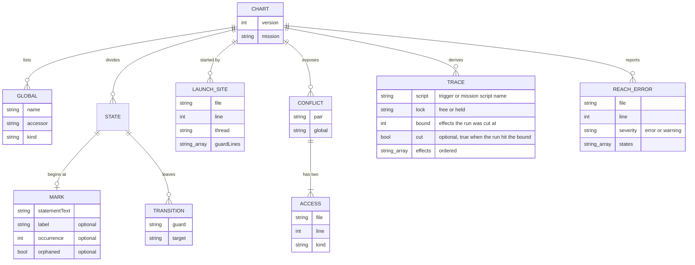
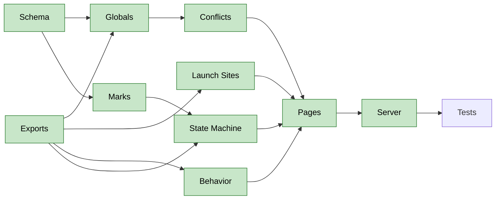

# Mission Baseline

Implements [Mission Baseline](../docs/epics/mission-baseline.md) on the
architecture in
[mission-baseline.arch.md](../docs/epics/mission-baseline.arch.md). Acceptance
criteria for every item are in the sibling
[mission-baseline.ac.md](mission-baseline.ac.md).

## Goal

The author opens a generated page for one mission and sees how it works today:
the globals it shares with threads, the conflicts with those threads, the places
that launch it, its states, and its effect traces. The author marks state
divisions (story beats) between lines on the page, and the server writes each
mark into `missions/<name>.chart.json`. The JSON is the source of truth, and an
agent reads it before the mutex and state machine work starts.

## Requirements

- Coverage: missions 1 to 6 (`Intro`, `Cop`, `Hotel`, `Work`, `Cart`, `BossDie`)
  and the threads each one starts, reads, or writes. Missions 7 to 10 are out of
  scope.
- Behavior comes from a program that reads the source. No recorded game run is
  part of the baseline.
- `tools/chart` is a Deno workspace package named `@eventide/chart`, added to
  the root `deno.json` workspace list. It imports `tools/cfg`,
  `tools/thread-graph`, and `tools/flow-model` as libraries.
- One `missions/<name>.chart.json` per mission, beside the script. Generated
  HTML goes to `dist/charts/<name>.html` and is never hand-authored.
- Derived content is rewritten on every run. Authored marks are never rewritten
  by a run.
- Marks go between lines, not on them, and split story beats. A mark stores the
  text of the statement immediately following the division, an optional label,
  and an optional occurrence. A mark whose statement is gone is flagged orphaned
  and is dropped only after the author confirms.
- `deno task chart:serve` starts the local server. It binds to `127.0.0.1` and
  writes only `missions/*.chart.json`.

## Technical Considerations

### System Overview

```mermaid
usecase-beta
direction LR
actor Author("Author")
actor Agent("Coding Agent")
systemBoundary Chart["Mission Baseline"]
  Regenerate("Regenerate a Chart")
  View("View a Mission Page")
  Mark("Mark a State")
  ReadJson("Read the Chart JSON")
  Assemble("Assemble Derived Content")
  Merge("Merge Marks")
  Render("Render the Page")
  Orphans("Report Orphaned Marks")
end
Author --> Regenerate
Author --> View
Author --> Mark
Agent --> ReadJson
Regenerate ..> : include Assemble
Regenerate ..> : include Merge
Regenerate ..> : include Render
Mark ..> : include Merge
Orphans ..> : extend Merge
```

The Author starts the regenerate command, opens a page, and marks states. The
Coding Agent reads the JSON.

| Module          | Role                                                                                                                        |
| --------------- | --------------------------------------------------------------------------------------------------------------------------- |
| Chart assembler | Calls `tools/cfg`, `tools/thread-graph`, and `tools/flow-model` for one mission and returns the derived content             |
| Marks merger    | Writes derived content into the JSON, keeps the authored marks, re-anchors each mark by statement text, and reports orphans |
| Page generator  | Renders one HTML page from one JSON file                                                                                    |
| Chart server    | Serves `dist/charts`, accepts a mark, and passes it to the merger                                                           |

Each module is a class with `#private` fields. The tests import them directly,
and the CLI only parses arguments and prints.

### Data Model



| Pair              | Meaning                                                                         |
| ----------------- | ------------------------------------------------------------------------------- |
| `mission-thread`  | A thread reads or writes a global that the running mission also reads or writes |
| `thread-thread`   | Two threads write the same global                                               |
| `trigger-mission` | A trigger starts a mission while another mission holds `$ONMISSION`             |

### Interface Design

| Surface                     | Does                                                               |
| --------------------------- | ------------------------------------------------------------------ |
| `deno task chart <mission>` | Regenerates the derived content of one mission's JSON and its page |
| `deno task chart:serve`     | Serves `dist/charts` and writes marks into `missions/*.chart.json` |

| Server Route                          | Does                                                                                                                |
| ------------------------------------- | ------------------------------------------------------------------------------------------------------------------- |
| `GET /<mission>.html`                 | Returns the generated page                                                                                          |
| `POST /<mission>/marks`               | Adds, relabels, or removes one mark; the body holds the statement text and the optional label                       |
| `GET /phrases/suggest?expression=...` | Returns a `compromise` suggestion for a condition with no Phrasebook row                                            |
| `POST /phrases`                       | Adds or edits one row of `./Phrasebook.csv`                                                                         |
| `POST /<mission>/regenerate`          | Rewrites the derived content of the mission's JSON from the source, keeps its marks, and returns the orphaned marks |

### Safety And Performance

- Behavior traces of a trigger run at bound 12, the bound
  `lib/mission-flow.test.ts` uses, and traces of a mission script run at bound
  24. The runner walks forward from the entry and groups the next moves by
  effect, so it holds the result and one path of at most `bound` steps. All six
  missions finish at bound 24 under the default 1500 MB cap, and heavy runs go
  through `deno task --cwd tools/flow-model capped`. A run that exceeds the cap
  stops and asks.
- The server rejects a request whose path is not a mission name from the DEFINE
  MISSION list for missions 1 to 6.

## Decisions

| Topic                   | Decision                                                                                                                                                                                                                                                                                                                                                                                                                                                                                                                                                                                                                                                                                                                                                                                                                                                                                                                                                          |
| ----------------------- | ----------------------------------------------------------------------------------------------------------------------------------------------------------------------------------------------------------------------------------------------------------------------------------------------------------------------------------------------------------------------------------------------------------------------------------------------------------------------------------------------------------------------------------------------------------------------------------------------------------------------------------------------------------------------------------------------------------------------------------------------------------------------------------------------------------------------------------------------------------------------------------------------------------------------------------------------------------------- |
| Package name            | `@eventide/chart` in `tools/chart`, next to the other workspace members                                                                                                                                                                                                                                                                                                                                                                                                                                                                                                                                                                                                                                                                                                                                                                                                                                                                                           |
| Mark anchor             | The statement text, matched exactly after whitespace is collapsed. Two identical statements in one mission anchor by order of appearance.                                                                                                                                                                                                                                                                                                                                                                                                                                                                                                                                                                                                                                                                                                                                                                                                                         |
| Markable statements     | Every leaf statement in the mission's reached blocks, and each compound statement (`if`, `while`, `repeat`) by its header line only, body excluded                                                                                                                                                                                                                                                                                                                                                                                                                                                                                                                                                                                                                                                                                                                                                                                                                |
| Duplicate statements    | A mark carries an optional 1-based `occurrence`, present only when its collapsed text appears more than once in the mission; absent means the first copy                                                                                                                                                                                                                                                                                                                                                                                                                                                                                                                                                                                                                                                                                                                                                                                                          |
| Orphans                 | A mark whose statement is gone stays in `marks` with `orphaned: true`, set or cleared by each run; the page surfaces each orphan as an error                                                                                                                                                                                                                                                                                                                                                                                                                                                                                                                                                                                                                                                                                                                                                                                                                      |
| Orphan resolution       | Three actions on the page: an "Accept Suggestion" button (moves the mark onto the statement with the most similar text), a click on any statement while the orphan is focused (moves the mark there), and a secondary trash icon button with the title "Remove" and the aria label `Remove orphaned mark on statement "<statement text>"` (discards the mark at once and shows an undo toast for a few seconds)                                                                                                                                                                                                                                                                                                                                                                                                                                                                                                                                                   |
| Orphan display          | Orphans render in an Orphaned group above the state list. The chart file has no position for a mark whose statement is gone.                                                                                                                                                                                                                                                                                                                                                                                                                                                                                                                                                                                                                                                                                                                                                                                                                                      |
| Accept Suggestion match | The statement whose collapsed text has the fewest single-letter inserts, deletes, and replacements from the orphan's text (plain Levenshtein distance). Ties go to the earlier statement in source order.                                                                                                                                                                                                                                                                                                                                                                                                                                                                                                                                                                                                                                                                                                                                                         |
| Undo window             | The undo message after discarding an orphan stays for 8 seconds.                                                                                                                                                                                                                                                                                                                                                                                                                                                                                                                                                                                                                                                                                                                                                                                                                                                                                                  |
| Page theme              | Dark only, using the dark tokens of `docs/palette.csv`, with no light theme and no switch to the system setting.                                                                                                                                                                                                                                                                                                                                                                                                                                                                                                                                                                                                                                                                                                                                                                                                                                                  |
| Mark control            | Like a GitHub inline comment: a plus icon beside each statement's line number appears on hover, and a click opens a form under that statement with an optional label field and Save and Cancel.                                                                                                                                                                                                                                                                                                                                                                                                                                                                                                                                                                                                                                                                                                                                                                   |
| No marks                | A mission with no marks is one state                                                                                                                                                                                                                                                                                                                                                                                                                                                                                                                                                                                                                                                                                                                                                                                                                                                                                                                              |
| Waits                   | A wait never marks a state by itself                                                                                                                                                                                                                                                                                                                                                                                                                                                                                                                                                                                                                                                                                                                                                                                                                                                                                                                              |
| Page location           | `dist/charts/`, removed by `deno task clean` and rebuilt by the generator                                                                                                                                                                                                                                                                                                                                                                                                                                                                                                                                                                                                                                                                                                                                                                                                                                                                                         |
| Schema version          | A `version` field in each JSON file; a version the tool does not know stops the run                                                                                                                                                                                                                                                                                                                                                                                                                                                                                                                                                                                                                                                                                                                                                                                                                                                                               |
| Schema format           | A hand-written `chart.schema.json` in `tools/chart`, validated with `npm:ajv`                                                                                                                                                                                                                                                                                                                                                                                                                                                                                                                                                                                                                                                                                                                                                                                                                                                                                     |
| Trace shape             | One entry per trace in `traces`: `script` (the trigger or the mission script that was run), `lock` (`free` or `held`), and `effects`, an ordered array of strings. The trigger is run with the lock free and held. The mission script is run once, with the lock held, because it starts after the trigger takes the lock.                                                                                                                                                                                                                                                                                                                                                                                                                                                                                                                                                                                                                                        |
| Trace bound             | Each trace stores its own `bound` and a `cut` flag that is true when the run hit the bound before the script ended. The chart has no top-level `traceBound`; `tools/chart/chart.schema.json`, `schema.ts`, `main.ts`, the tests, and the `missions/*.chart.json` files drop it. The flow-model runner reports which traces were cut.                                                                                                                                                                                                                                                                                                                                                                                                                                                                                                                                                                                                                              |
| Library entry points    | Each of `tools/cfg`, `tools/thread-graph`, and `tools/flow-model` has a `mod.ts` that re-exports its public classes and types, and its `exports` points at `mod.ts`                                                                                                                                                                                                                                                                                                                                                                                                                                                                                                                                                                                                                                                                                                                                                                                               |
| Conflict threads        | The thread side of a conflict is `MAIN`, CLEO scripts, and thread-kind scripts. Every script of kind `mission` (missions 0 to 10, so `INIT`, `Fairy`, and `Endgame` too) is skipped, because the engine runs one mission at a time.                                                                                                                                                                                                                                                                                                                                                                                                                                                                                                                                                                                                                                                                                                                               |
| Conflict scope          | A conflict is about a global the mission touches. `mission-thread` needs at least one write among its two accesses, and `thread-thread` needs both accesses to be writes by two different threads.                                                                                                                                                                                                                                                                                                                                                                                                                                                                                                                                                                                                                                                                                                                                                                |
| Conflict entries        | The JSON holds one entry per global and site pair, complete and exact. Each entry has a required `global` field. The page groups entries by global and thread.                                                                                                                                                                                                                                                                                                                                                                                                                                                                                                                                                                                                                                                                                                                                                                                                    |
| Trigger-mission         | An entry for each launch of missions 1 to 6 whose guard lines have no read of `$ONMISSION`, listed on the chart of every mission, whichever mission it launches. The entry has `global` `$ONMISSION` and one access, the launch call. A conflict has one or two accesses.                                                                                                                                                                                                                                                                                                                                                                                                                                                                                                                                                                                                                                                                                         |
| State count             | Marks go between lines, not on them, and split story beats. N marks make N plus one states: an unlabeled start state from the entry to the first mark, dropped when the first mark sits before the first statement. An orphaned mark begins no state.                                                                                                                                                                                                                                                                                                                                                                                                                                                                                                                                                                                                                                                                                                             |
| State membership        | A state holds every statement reachable by control flow from its mark without crossing another mark, and `gosub` calls are followed. Waits do not split states.                                                                                                                                                                                                                                                                                                                                                                                                                                                                                                                                                                                                                                                                                                                                                                                                   |
| State transitions       | A transition leaves a state by an edge that reaches another mark. Its `guard` is Gherkin on separate lines. A negated chain (`goto_if_false` jump) is negated and minimized by a boolean-logic package, never by hand-written rules, and each alternative of the result is its own `When` line with no heading. Each `When` line uses the active phrase of its condition, each `And` line a nominal phrase, and a negated condition its opposite phrase. An unconditional jump has the empty guard. Its `target` is the target state's label, else `State N` counting from 1.                                                                                                                                                                                                                                                                                                                                                                                     |
| Guard package           | `logi.js` negates and minimizes guard logic. It takes an expression string, so each condition is mapped to a letter, negated with `~`, minimized, and mapped back.                                                                                                                                                                                                                                                                                                                                                                                                                                                                                                                                                                                                                                                                                                                                                                                                |
| Guard phrases           | A guard condition is written in Gherkin English, such as "not on a mission" for `$ONMISSION == 0`, from a Phrasebook CSV that maps Sanny expressions to English in nominal, opposite, and active tenses. The agent drafts the Phrasebook. A no-call condition such as `$TIMER == 0` and each command such as `Player.IsPlaying` get a Phrasebook entry, and a command's arguments follow its English with the parameter names from the installed VC library before their values, the coordinates of a 2D or 3D point are grouped together without the x, y, and z names, the radii of a locate command are grouped the same way as `radius (3.0, 3.0, 3.0)`, and the instance argument (`self`) is dropped. No grammar for every Sanny expression is built. A condition with no phrase shows its source text, the page flags it as an error, and the author types the phrase in a modal dialog. The server API suggests phrases generated from the Sanny library. |
| Phrasebook file         | `./Phrasebook.csv` at the repository root, with the columns nominal (the state, "the player is playing"), opposite (the negated state, "the player is not playing"), and active (the event, "the player starts playing"). Suggested phrases come from programmatic natural-language processing.                                                                                                                                                                                                                                                                                                                                                                                                                                                                                                                                                                                                                                                                   |
| Phrase suggestions      | The server API suggests a phrase for an unphrased condition with `compromise` 14.19.0 (MIT, ESM and CJS, types, no model download), using `.verbs().toNegative()` for the opposite column, from the installed VC library data (`class`, `member`, `short_desc`). A suggestion leaves the active column blank for the author to type.                                                                                                                                                                                                                                                                                                                                                                                                                                                                                                                                                                                                                              |
| Unphrased conditions    | A condition with no Phrasebook entry is an entry in the top-level `errors` array with a `kind` of `unphrased` and the expression text.                                                                                                                                                                                                                                                                                                                                                                                                                                                                                                                                                                                                                                                                                                                                                                                                                            |
| Guard package loading   | `logi.js` 0.1.8 is in the root `deno.json` import map. Its ESM entry fails in Deno with a missing `defaultTokens` module, because its re-exports have no file extension and its `exports` map allows only the root. `tools/chart` loads the CJS build with `createRequire` from `node:module`, based at the repository `deno.json`.                                                                                                                                                                                                                                                                                                                                                                                                                                                                                                                                                                                                                               |
| Statement graph         | The statement graph and the cut into states live in `tools/cfg` (`statements.ts`), built on the `tools/thread-graph` parser, and `tools/chart` imports them by package name. `ControlFlow` and its command output stay as they are. The `tools/cfg` command prints the statement graph with a `--statements` flag, and `AGENTS.md` has a line for it.                                                                                                                                                                                                                                                                                                                                                                                                                                                                                                                                                                                                             |
| Boolean flags           | A global whose every write is `0`, `1`, `true`, or `false` is a boolean flag. `$V == 1` is the flag and `$V == 0` is its negation, so the Phrasebook has one row keyed `$V` and no `== 0` or `== 1` rows.                                                                                                                                                                                                                                                                                                                                                                                                                                                                                                                                                                                                                                                                                                                                                         |
| Reach errors            | A top-level `errors` array in the JSON, derived on every run. Each entry has `file`, `line`, `severity`, and `states` (the states that reach it); the statement text is read from the source at that line and is not stored. A statement reached from two states is an `error`, and one reached only through `gosub` calls is a `warning` that tells the author to refactor the subroutine into a function. The run still writes the file.                                                                                                                                                                                                                                                                                                                                                                                                                                                                                                                        |

## Work Items

| Item          | Kind    | Summary                                                                                                              | Size | Priority | Status      |
| ------------- | ------- | -------------------------------------------------------------------------------------------------------------------- | ---- | -------- | ----------- |
| Schema        | Enabler | `tools/chart` package, workspace entry, JSON schema with a version field, `AGENTS.md` run line                       | 3    | P0       | Done        |
| Exports       | Enabler | Library entry points on `tools/cfg`, `tools/thread-graph`, and `tools/flow-model`, each a `mod.ts`                   | 3    | P0       | Done        |
| Globals       | Story   | Shared globals per mission, each with its reader or writer                                                           | 5    | P0       | Done        |
| Launch Sites  | Story   | Each place where a trigger launches the mission with `Mission.LoadAndLaunchInternal`: file, line, trigger, guards    | 3    | P0       | Done        |
| Conflicts     | Story   | The three pairs, each with both access sites                                                                         | 5    | P0       | Done        |
| State Machine | Story   | States from marks, guards and transitions from the `tools/cfg` statement graph                                       | 5    | P0       | Done        |
| Behavior      | Story   | Effect traces of trigger and mission script at a measured bound each, with a cut flag the runner reports             | 5    | P1       | Done        |
| Marks         | Story   | Marks merger with statement-text re-anchoring and orphan report                                                      | 5    | P0       | Done        |
| Pages         | Story   | HTML page per mission in `dist/charts`, with each orphaned mark shown as an error the author can reattach or discard | 5    | P1       | Done        |
| Server        | Story   | `chart:serve` with the mark route and the regenerate route                                                           | 5    | P1       | Done        |
| Tests         | Test    | Golden JSON per mission, marks round trip, orphan, and server write tests                                            | 5    | P0       | Open        |

The total is 49 points. Work proceeds in dependency order.



The chart draws each dependency once, through the longest path. The table lists
every direct blocker.

| Item          | Blocked By                                                |
| ------------- | --------------------------------------------------------- |
| Globals       | Schema, Exports                                           |
| Launch Sites  | Schema, Exports                                           |
| Conflicts     | Exports, Globals                                          |
| State Machine | Exports, Marks                                            |
| Behavior      | Exports                                                   |
| Marks         | Schema                                                    |
| Pages         | Globals, Launch Sites, Conflicts, State Machine, Behavior |
| Server        | Marks, Pages                                              |
| Tests         | Marks, Pages, Server                                      |

## Risks

| Risk                                                                                     | Mitigation                                                                                                      |
| ---------------------------------------------------------------------------------------- | --------------------------------------------------------------------------------------------------------------- |
| A mission script's traces at bound 24 exceed the memory cap                              | The run goes through the capped runner and records each trace's bound; a resource stop names the cap that fired |
| A source edit moves a statement and orphans a mark                                       | Marks anchor by statement text, and the run lists orphans without dropping them                                 |
| `tools/flow-model` `mod.ts` leaves out `capped.ts`, which opens `kernel32.dll` at import | Behavior reaches the capped runner through its task, or imports `capped.ts` with `--allow-ffi`                  |
| Two identical statements in a mission confuse the anchor                                 | Order of appearance breaks the tie, and a test covers it                                                        |
