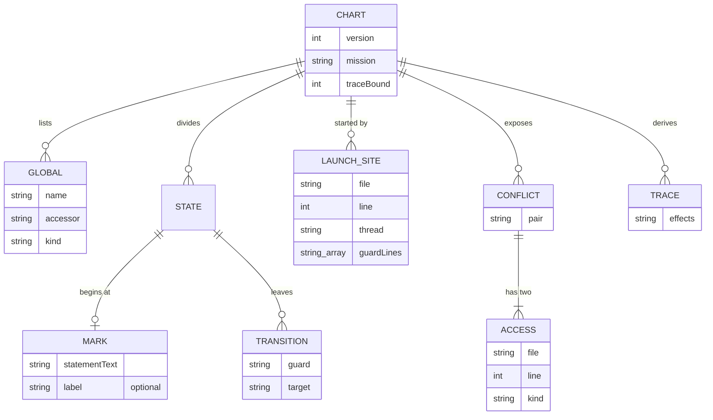
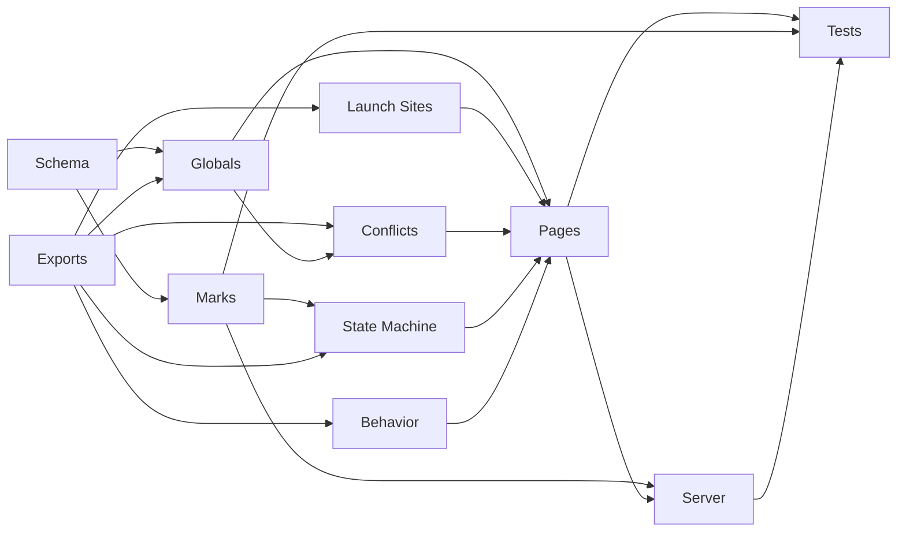

# Mission Baseline

Implements [Mission Baseline](../docs/epics/mission-baseline.md) on the
architecture in
[mission-baseline.arch.md](../docs/epics/mission-baseline.arch.md). Acceptance
criteria for every item are in the sibling
[mission-baseline.ac.md](mission-baseline.ac.md).

## Goal

The author opens a generated page for one mission and sees how it works today:
the globals it shares with threads, the conflicts with those threads, the places
that launch it, its states, and its effect traces. The author marks state
divisions on the page, and the server writes each mark into
`missions/<name>.chart.json`. The JSON is the source of truth, and an agent
reads it before the mutex and state machine work starts.

## Requirements

- Coverage: missions 1 to 6 (`Intro`, `Cop`, `Hotel`, `Work`, `Cart`, `BossDie`)
  and the threads each one starts, reads, or writes. Missions 7 to 10 are out of
  scope.
- Behavior comes from a program that reads the source. No recorded game run is
  part of the baseline.
- `tools/chart` is a Deno workspace package named `@eventide/chart`, added to
  the root `deno.json` workspace list. It imports `tools/cfg`,
  `tools/thread-graph`, and `tools/flow-model` as libraries.
- One `missions/<name>.chart.json` per mission, beside the script. Generated
  HTML goes to `dist/charts/<name>.html` and is never hand-authored.
- Derived content is rewritten on every run. Authored marks are never rewritten
  by a run.
- A mark stores the text of its statement and an optional label. A mark whose
  statement is gone is reported as orphaned and is dropped only after the author
  confirms.
- `deno task chart:serve` starts the local server. It binds to `127.0.0.1` and
  writes only `missions/*.chart.json`.

## Technical Considerations

### System Overview

```mermaid
usecase-beta
direction LR
actor Author("Author")
actor Agent("Coding Agent")
systemBoundary Chart["Mission Baseline"]
  Regenerate("Regenerate a Chart")
  View("View a Mission Page")
  Mark("Mark a State")
  ReadJson("Read the Chart JSON")
  Assemble("Assemble Derived Content")
  Merge("Merge Marks")
  Render("Render the Page")
  Orphans("Report Orphaned Marks")
end
Author --> Regenerate
Author --> View
Author --> Mark
Agent --> ReadJson
Regenerate ..> : include Assemble
Regenerate ..> : include Merge
Regenerate ..> : include Render
Mark ..> : include Merge
Orphans ..> : extend Merge
```

The Author starts the regenerate command, opens a page, and marks states. The
Coding Agent reads the JSON.

| Module          | Role                                                                                                                        |
| --------------- | --------------------------------------------------------------------------------------------------------------------------- |
| Chart assembler | Calls `tools/cfg`, `tools/thread-graph`, and `tools/flow-model` for one mission and returns the derived content             |
| Marks merger    | Writes derived content into the JSON, keeps the authored marks, re-anchors each mark by statement text, and reports orphans |
| Page generator  | Renders one HTML page from one JSON file                                                                                    |
| Chart server    | Serves `dist/charts`, accepts a mark, and passes it to the merger                                                           |

Each module is a class with `#private` fields. The tests import them directly,
and the CLI only parses arguments and prints.

### Data Model



| Pair              | Meaning                                                                         |
| ----------------- | ------------------------------------------------------------------------------- |
| `mission-thread`  | A thread reads or writes a global that the running mission also reads or writes |
| `thread-thread`   | Two threads write the same global                                               |
| `trigger-mission` | A trigger starts a mission while another mission holds `$ONMISSION`             |

### Interface Design

| Surface                     | Does                                                               |
| --------------------------- | ------------------------------------------------------------------ |
| `deno task chart <mission>` | Regenerates the derived content of one mission's JSON and its page |
| `deno task chart:serve`     | Serves `dist/charts` and writes marks into `missions/*.chart.json` |

| Server Route            | Does                                                                                          |
| ----------------------- | --------------------------------------------------------------------------------------------- |
| `GET /<mission>.html`   | Returns the generated page                                                                    |
| `POST /<mission>/marks` | Adds, relabels, or removes one mark; the body holds the statement text and the optional label |

### Safety And Performance

- Behavior traces run at trace bound 24. The bound is unmeasured:
  `tools/flow-model` uses 12 today, and enumerating every trace at bound 40
  exhausts a 1500 MB heap for Cop and Intro. Behavior counts the instructions
  and traces of each mission with the `tools/flow-model` library before it keeps
  24, and heavy runs go through `deno task --cwd tools/flow-model capped`.
- The server rejects a request whose path is not a mission name from the DEFINE
  MISSION list for missions 1 to 6.
- The server writes a JSON file to a temporary file and renames it, so a stop
  mid-write leaves the old file.

## Decisions

| Topic                | Decision                                                                                                                                                            |
| -------------------- | ------------------------------------------------------------------------------------------------------------------------------------------------------------------- |
| Package name         | `@eventide/chart` in `tools/chart`, next to the other workspace members                                                                                             |
| Mark anchor          | The statement text, matched exactly after whitespace is collapsed. Two identical statements in one mission anchor by order of appearance.                           |
| No marks             | A mission with no marks is one state                                                                                                                                |
| Waits                | A wait never marks a state by itself                                                                                                                                |
| Page location        | `dist/charts/`, removed by `deno task clean` and rebuilt by the generator                                                                                           |
| Schema version       | A `version` field in each JSON file; a version the tool does not know stops the run                                                                                 |
| Schema format        | A hand-written `chart.schema.json` in `tools/chart`, validated with `npm:ajv`                                                                                       |
| Library entry points | Each of `tools/cfg`, `tools/thread-graph`, and `tools/flow-model` has a `mod.ts` that re-exports its public classes and types, and its `exports` points at `mod.ts` |

## Work Items

| Item          | Kind    | Summary                                                                                                  | Size | Priority | Status |
| ------------- | ------- | -------------------------------------------------------------------------------------------------------- | ---- | -------- | ------ |
| Schema        | Enabler | `tools/chart` package, workspace entry, JSON schema with a version field, `AGENTS.md` run line           | 3    | P0       | Done   |
| Exports       | Enabler | Library entry points on `tools/cfg`, `tools/thread-graph`, and `tools/flow-model`, each a `mod.ts`      | 3    | P0       | Done   |
| Globals       | Story   | Shared globals per mission, each with its reader or writer                                               | 5    | P0       | Open   |
| Launch Sites  | Story   | Each `Mission.LoadAndLaunchInternal` call with file, line, enclosing thread, and guard lines             | 3    | P0       | Open   |
| Conflicts     | Story   | The three pairs, each with both access sites                                                             | 5    | P0       | Open   |
| State Machine | Story   | States from marks, guards and transitions from control-flow blocks                                       | 5    | P0       | Open   |
| Behavior      | Story   | Effect traces at the measured bound, recorded in the JSON                                                | 5    | P1       | Open   |
| Marks         | Story   | Marks merger with statement-text re-anchoring and orphan report                                          | 5    | P0       | Open   |
| Pages         | Story   | HTML page per mission in `dist/charts`                                                                   | 5    | P1       | Open   |
| Server        | Story   | `chart:serve` with the mark route                                                                        | 5    | P1       | Open   |
| Tests         | Test    | Golden JSON per mission, marks round trip, orphan, and server write tests                                | 5    | P0       | Open   |

The total is 49 points. Work proceeds in dependency order.



| Item          | Blocked By                                                |
| ------------- | --------------------------------------------------------- |
| Globals       | Schema, Exports                                           |
| Launch Sites  | Schema, Exports                                           |
| Conflicts     | Exports, Globals                                          |
| State Machine | Exports, Marks                                            |
| Behavior      | Exports                                                   |
| Marks         | Schema                                                    |
| Pages         | Globals, Launch Sites, Conflicts, State Machine, Behavior |
| Server        | Marks, Pages                                              |
| Tests         | Marks, Pages, Server                                      |

## Risks

| Risk                                                     | Mitigation                                                                                                                       |
| -------------------------------------------------------- | -------------------------------------------------------------------------------------------------------------------------------- |
| Trace bound 24 exceeds the memory cap for Cop or Intro   | Behavior measures first, runs through the capped runner, and records the bound it used; a resource stop names the cap that fired |
| A source edit moves a statement and orphans a mark       | Marks anchor by statement text, and the run lists orphans without dropping them                                                  |
| `tools/flow-model` `mod.ts` leaves out `capped.ts`, which opens `kernel32.dll` at import | Behavior reaches the capped runner through its task, or imports `capped.ts` with `--allow-ffi`                                                                                 |
| Two identical statements in a mission confuse the anchor | Order of appearance breaks the tie, and a test covers it                                                                         |
